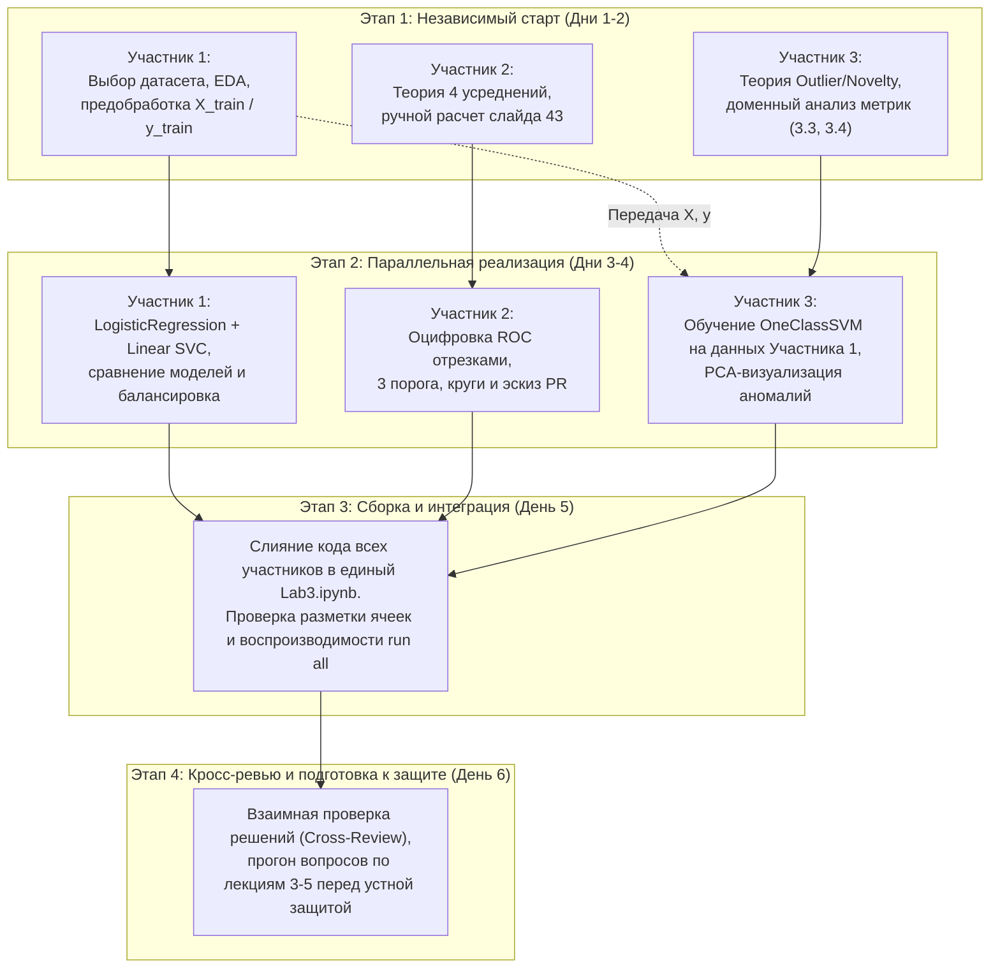

# План выполнения Лабораторной работы №3: «Задача классификации»

## 1. Общие сведения и регламент сдачи

* **Всего баллов:** 12 баллов.
* **Целевой файл:** `Lab3.ipynb`.
* **Количество участников:** 3 человека.
* **Распределение баллов:** ровно по **4 балла** на каждого участника ($12 / 3 = 4.0$).
* **Ключевые требования преподавателя:**
  1. **Шаблон ноутбука:** решать строго в предоставленном ноутбуке `Lab3.ipynb`. Разрешено добавлять новые ячейки, но **запрещено удалять текстовые ячейки с формулировками заданий**.
  2. **Код:** все вычисления должны подкрепляться работающим, воспроизводимым кодом на Python.
  3. **Выводы:** обязательны развернутые текстовые выводы (markdown, LaTeX-формулы, графики, таблицы). Ответы без выводов не оцениваются на полный балл.
  4. **Устная защита:** обязательный этап. Без защиты баллы за работу не начисляются. Вопросы охватывают как практику, так и теоретический лекционный материал (Лекции 3, 4, 5).

---

## 2. Общая декомпозиция заданий лабораторной работы

### Задание 1. Выбор данных и бинарная логистическая регрессия [2 балла]
1. **Выбор датасета:** подобрать актуальный датасет с Kaggle или UCI ML Repository ($N \ge 100$ объектов). Рекомендуется использовать датасет из предыдущих ЛР для преемственности.
2. **Целевой признак:** выделить или сгенерировать бинарный целевой признак ($y \in \{0, 1\}$).
3. **Предобработка:** очистка от пропусков, кодирование категориальных признаков (One-Hot / Ordinal), масштабирование (`StandardScaler` / `MinMaxScaler`), разбиение на `train` и `test` со стратификацией (`stratify=y`).
4. **Обучение LogisticRegression:** обучение модели из `sklearn.linear_model.LogisticRegression`.
5. **Анализ гиперпараметров:** ручная настройка нескольких параметров (`C`, `penalty`, `solver`, `max_iter`, `class_weight`) с детальным теоретическим обоснованием каждого.
6. **Оценка качества:** расчет пула метрик (`Accuracy`, `Precision`, `Recall`, `F1-score`, `ROC-AUC`, `Confusion Matrix`, `classification_report`). Формулирование выводов.

### Задание 2. Бинарная классификация с помощью линейного SVM [2 балла]
1. **Обучение Linear SVM:** использование `SVC` из `sklearn.svm` с фиксированным параметром `kernel='linear'`.
2. **Подбор параметра регуляризации $C$:** перебор значений $C$ (например, $10^{-3} \dots 10^3$), анализ влияния на ширину разделяющей полосы и переобучение/недообучение, выбор оптимального значения.
3. **Метрики и сопоставление:** расчет того же пула метрик, детальное сравнение работы `LogisticRegression` и линейного `SVC` (скорость, разделяющая способность, интерпретируемость весов).
4. **Теоретический и практический вопрос:** развернутый ответ на вопрос: *«Может ли и как именно SVM учесть несбалансированность классов?»* (анализ взвешивания ошибок `class_weight='balanced'`, индивидуальные штрафы $C^+$ и $C^-$, сдвиг порога разделяющей гиперплоскости).

### Задание 3. Теория метрик, многоклассовая классификация и оцифровка [6 баллов]
* **Пункт 3.1 [2 балла] — Усреднения и ручной расчет по слайду 43:**
  - Строгие математические определения 4 подходов:
    * **Micro-average** (микро-усреднение по суммарным TP, FP, FN);
    * **Macro-average** (макро-усреднение без учета размера классов);
    * **Weighted-average** (взвешенное усреднение по поддержке классов $P_i$);
    * **Samples-average** (пообъектное усреднение по строкам матрицы).
  - Ручной расчет характеристик со слайда 43 Лекции 4:
    * Исходные матрицы 4×3: Матрица классификаций (ground truth) и Матрица предсказанных вероятностей;
    * Расчет 3 промежуточных AUC ROC по классам ($AUC_1=0.750, AUC_2=0.667, AUC_3=1.000$) и по объектам ($x_1=1.0, x_2=1.0, x_3=1.0, x_4=0.5$);
    * Подробный пошаговый вывод 4 финальных метрик: `macro` (0.806), `weighted` (0.750), `micro` (0.833), `samples` (0.875).
  - **ОЦИФРОВКА ROC:** программная отрисовка ROC-кривой отдельными отрезками на Python с помощью `matplotlib` **без использования готовых функций** (таких как `sklearn.metrics.roc_curve`).
* **Пункт 3.2 [2 балла] — Пороги бинаризации, ручной расчет и PR-эскиз:**
  - Выбор одного класса из кейса.
  - Введение трех порогов бинаризации ($\theta_1, \theta_2, \theta_3$), обеспечивающих разные соотношения ошибок.
  - Ручной расчет `Accuracy`, `Precision`, `Recall` для каждого порога (расписать матрицы ошибок TP, FP, TN, FN).
  - Наглядная визуализация расчетов Precision и Recall в стиле лекции (круги объектов / окружности разных цветов и радиусов, иллюстрирующие истинные и предсказанные объекты).
  - Построение эскиза **PR-кривой** (Precision-Recall curve) по трем полученным точкам с пояснениями.
* **Пункт 3.3 [1 балл] — Анализ результатов многоклассового AUC ROC:**
  - Сравнение вариантов усреднения (какой объективнее отражает качество и в каких условиях).
  - Аналитическое объяснение эффекта падения AUC ROC при переходе к многоклассовой постановке (One-vs-Rest, взаимное наложение ошибок, размывание разделяющих границ).
* **Пункт 3.4 [1 балл] — Доменный анализ применимости:**
  - Систематизация применения подходов (`Micro`, `Macro`, `Weighted`, `Samples`) по предметным областям.
  - Разбор реальных сценариев (медицинская диагностика редких патологий, фильтрация спама, мультилейбл аннотация текстов/изображений, финансовый фрод).

### Задание 4. Исследование выбросов и новизны с OneClassSVM [2 балла]
1. **Теоретическая база:**
   - Различие между поиском выбросов (*Outlier Detection*) и поиском новизны (*Novelty Detection*).
   - Математическая концепция `One-Class SVM` (опорная гиперсфера Шёлькопфа, разделение данных от начала координат в спрямляющем пространстве, роль ядра RBF).
   - Назначение гиперпараметров $\nu$ (`nu` — верхняя оценка доли ошибок и нижняя оценка доли опорных векторов) и $\gamma$ (`gamma`).
2. **Практическая реализация:**
   - Обучение `OneClassSVM` из `sklearn.svm` на признаковом пространстве датасета.
   - Идентификация объектов-выбросов, расчет процента аномалий.
3. **Визуализация:**
   - Построение графика разделяющей границы (на двух наиболее информативных признаках либо через проекцию PCA/t-SNE) с цветовым выделением нормальных наблюдений и аномалий.
4. **Выводы:**
   - Анализ влияния выявленных выбросов на качество классификаторов из Заданий 1 и 2;
   - Рекомендации по фильтрации данных для повышения обобщающей способности моделей.

---

## 3. Распределение работы на 3 человека (по 4 балла каждому)

Деление произведено с соблюдением идеального паритета по баллам, сбалансированной трудоемкости и минимизации блокировок при параллельной разработке:

| Участник | Зона ответственности | Входящие задачи | Баллы | Формат результата |
| :--- | :--- | :--- | :---: | :--- |
| **Участник 1** | **ML Engineer:** Данные и линейные классификаторы | **Задание 1** [2 б.] **Задание 2** [2 б.] | **4.0** | Подготовка датасета, EDA, код и эксперименты с `LogisticRegression` и `Linear SVC`, сравнительный анализ моделей, обоснование учета дисбаланса классов в SVM. |
| **Участник 2** | **Math & Viz Specialist:** Теория метрик, расчеты и кривые | **Задание 3.1** [2 б.] **Задание 3.2** [2 б.] | **4.0** | Теория 4 усреднений, пошаговые ручные расчеты слайда 43, оцифровка ROC отрезками без готовых функций, 3 порога бинаризации с матрицами ошибок, визуализация кругами и эскиз PR-кривой. |
| **Участник 3** | **Analytics & Outliers:** Анализ доменов и детекция аномалий | **Задание 3.3** [1 б.] **Задание 3.4** [1 б.] **Задание 4** [2 б.] | **4.0** | Анализ причин падения многоклассового AUC ROC, доменный обзор применимости метрик, теория Outlier vs Novelty Detection, реализация `OneClassSVM`, визуализация аномалий (PCA), выводы о влиянии выбросов. |

---

## 4. Детальные персональные ТЗ для каждого участника

### 👤 Участник 1: Подготовка данных, Logistic Regression и Linear SVM (4 балла)
* **Задачи:**
  1. Выбрать датасет ($N \ge 100$) на Kaggle/UCI (можно использовать датасет из ЛР1/ЛР2), определить бинарную целевую переменную.
  2. Написать модуль предобработки: очистка, кодирование признаков, масштабирование через `StandardScaler`, разделение `train_test_split(..., test_size=0.25, random_state=42, stratify=y)`. Экспортировать готовые `X_train, X_test, y_train, y_test` для использования Участником 3 в Задании 4.
  3. Обучить `LogisticRegression`:
     - Варьировать параметры `C`, `penalty`, `solver`, `class_weight`.
     - Написать текстовый блок с объяснением смысла каждого параметра и причин выбора финальных значений.
     - Посчитать метрики: Accuracy, Precision, Recall, F1, ROC-AUC, вывести матрицу ошибок.
  4. Обучить `SVC(kernel='linear')`:
     - Подобрать параметр регуляризации $C$ по сетке (`GridSearchCV` или цикл).
     - Посчитать те же метрики, составить сравнительную таблицу `LogisticRegression` vs `Linear SVM`.
  5. Ответить на вопрос: как SVM учитывает несбалансированность классов:
     - Описать работу параметра `class_weight='balanced'`.
     - Математически объяснить модификацию функционала качества с разными весами ошибок $C^+$ и $C^-$.
     - Проверить влияние балансировки на практике (сравнить метрики до и после).

---

### 👤 Участник 2: Математика усреднений, расчеты по слайду 43, оцифровка ROC и PR-анализ (4 балла)
* **Задачи (не зависят от датасета, можно выполнять сразу):**
  1. Написать строгие определения и формулы для 4 подходов многоклассового усреднения:
     - **Micro-average:** объединение всех TP, FP, FN в общую матрицу и вычисление глобальной метрики;
     - **Macro-average:** простое арифметическое среднее метрик по всем классам;
     - **Weighted-average:** взвешенное среднее по количеству истинных объектов каждого класса ($P_i$);
     - **Samples-average:** вычисление метрики отдельно для каждого объекта (по строкам) с последующим усреднением.
  2. Воспроизвести ручные расчеты по слайду 43 Лекции 4:
     - Описать входные данные (4 объекта, 3 класса): истинные метки $Y$ и вероятности $\hat{P}$.
     - Вычислить промежуточные AUC ROC по классам ($AUC_1 = 0.750, AUC_2 = 0.667, AUC_3 = 1.000$) и по объектам ($x_1=1.0, x_2=1.0, x_3=1.0, x_4=0.5$).
     - Продемонстрировать пошаговый расчет и получение итоговых значений:
       $$\text{macro} = \frac{0.750 + 0.667 + 1.000}{3} \approx 0.806$$
       $$\text{weighted} = \frac{2 \cdot 0.750 + 3 \cdot 0.667 + 1 \cdot 1.000}{6} = 0.750$$
       $$\text{micro} = 0.833, \quad \text{samples} = \frac{1.0 + 1.0 + 1.0 + 0.5}{4} = 0.875$$
  3. **Оцифровать ROC-кривую:**
     - Написать Python-скрипт с `matplotlib`, который строит ступенчатую ROC-кривую вручную по точкам/отрезкам (перебирая пороги и рассчитывая TPR и FPR) **без вызова `roc_curve` из sklearn**.
  4. Провести анализ порогов для одного класса (Задание 3.2):
     - Задать 3 порога ($\theta_1 < \theta_2 < \theta_3$), при которых метрики существенно различаются.
     - Для каждого порога вручную расписать TP, FP, TN, FN и рассчитать Accuracy, Precision, Recall.
     - Отрисовать диаграммы с окружностями (круги Эйлера / круги объектов истинного класса vs предсказанных классификатором объектов) по аналогии со слайдами лекции.
     - По 3 парам $(Recall, Precision)$ построить эскиз PR-кривой.

---

### 👤 Участник 3: Аналитика метрик в доменах и исследование OneClassSVM (4 балла)
* **Задачи:**
  1. Выполнить аналитические пункты по многоклассовой классификации:
     - **Пункт 3.3:** Проанализировать результаты AUC ROC (сравнить Micro vs Macro vs Weighted vs Samples). Объяснить феномен падения многоклассового AUC ROC (проблема дисбаланса в схеме One-vs-Rest, накопление ложных срабатываний на фоне преобладающего негативного класса).
     - **Пункт 3.4:** Описать домены применения:
       * *Macro:* когда все классы одинаково важны, независимо от их частоты (диагностика редких опасных болезней, классификация типов дефектов);
       * *Micro:* когда важен общий валовый объем корректных решений (высоконагруженные классификаторы поисковых запросов);
       * *Weighted:* когда штраф за ошибки должен быть пропорционален распространенности классов в генеральной совокупности;
       * *Samples:* мультилейбл задачи, где каждому объекту приписывается несколько тегов (тегирование статей, распознавание нескольких объектов на фото).
  2. Выполнить Задание 4 (OneClassSVM):
     - Написать теоретическое введение: отличие поиска выбросов (в обучающей выборке уже есть шум) от поиска новизны (обучение на чистых нормальных данных, детектирование новых явлений).
     - Описать математику `OneClassSVM`: поиск разделяющей гиперплоскости с максимальным отступом от начала координат в пространстве признаков, роль гиперпараметров $\nu$ (`nu` $\in (0, 1]$) и ядра RBF с коэффициентом $\gamma$.
     - Применить `sklearn.svm.OneClassSVM` на признаках датасета (полученных от Участника 1).
     - Найти долю и индексы обнаруженных аномалий.
     - Построить качественную 2D-визуализацию: спроецировать данные с помощью PCA до 2 компонент, нарисовать разделяющую границу (контурную сетку плотности решений) и подсветить точки-выбросы.
     - Сделать вывод: как наличие этих аномалий сказывалось на метриках логистической регрессии и SVM из Заданий 1-2, и улучшится ли качество при их удалении.

---

## 5. Календарный план и синхронизация (Roadmap)

### График выполнения по шагам:
1. **Шаг 1 (Старт):**
   * Участник 1 фиксирует датасет и публикует функцию препроцессинга.
   * Участник 2 сразу начинает расчеты по слайду 43 и формулирует определения усреднений.
   * Участник 3 оформляет ответы на теоретические вопросы 3.3, 3.4 и готовит теоретическое описание OneClassSVM.
2. **Шаг 2 (Реализация):**
   * Участник 1 завершает обучение `LogisticRegression` и `Linear SVC`, проводит анализ регуляризации $C$ и весов классов.
   * Участник 2 пишет код оцифровки ROC-кривой и строит PR-эскиз с визуализацией кругами.
   * Участник 3 берет предобработанные данные Участника 1, обучает `OneClassSVM`, строит график выбросов и оформляет аналитические выводы.
3. **Шаг 3 (Интеграция):**
   * Совместная вставка блоков в единый шаблон `Lab3.ipynb`.
   * Проверка: ни одна текстовая ячейка с заданием преподавателя не удалена, код выполняется сверху вниз по кнопке `Restart & Run All` без ошибок и предупреждений.
4. **Шаг 4 (Подготовка к защите):**
   * Взаимный опрос по лекционному материалу:
     - Почему в SVM используется опорная полоса и как работает soft-margin?
     - Чем отличается LogLoss от Hinge Loss?
     - Почему падает Macro AUC ROC при сильном дисбалансе?
     - В чем различие между $\nu$-SVM и $C$-SVM?

---

## 6. Чек-лист готовности к сдаче работы

- [ ] Выбран актуальный датасет ($N \ge 100$), задача бинарной классификации сформулирована четко.
- [ ] Обучена `LogisticRegression`, обоснован каждый измененный параметр, рассчитан полный набор метрик.
- [ ] Обучен `Linear SVC`, подобран параметр $C$, проведено сравнение с логистической регрессией.
- [ ] Дано исчерпывающее объяснение работы SVM с несбалансированными классами (`class_weight`, штрафы).
- [ ] Расписаны формулы и физический смысл 4 видов усреднения (micro, macro, weighted, samples).
- [ ] Пошагово и наглядно воспроизведен ручной расчет по слайду 43 (промежуточные AUC ROC и 4 финальных значения).
- [ ] ROC-кривая оцифрована и нарисована ручным кодом без применения готовых функций `sklearn`.
- [ ] Введены 3 порога бинаризации, вручную посчитаны метрики, нарисованы круги объектов и эскиз PR-кривой.
- [ ] Объяснены причины падения AUC ROC при переходе к многоклассовой задаче.
- [ ] Приведен подробный анализ применимости вариантов усреднения по предметным областям.
- [ ] Дана теория `OneClassSVM`, описаны различия Outlier и Novelty detection, раскрыт смысл параметров $\nu$ и $\gamma$.
- [ ] Модель `OneClassSVM` обучена на датасете, визуализирована разделяющая граница и аномалии, сделаны выводы.
- [ ] Ноутбук чистый, оформлен в едином стиле markdown, код полностью воспроизводим.
- [ ] Все 3 участника владеют материалом всей лабораторной работы и готовы к устной защите.

